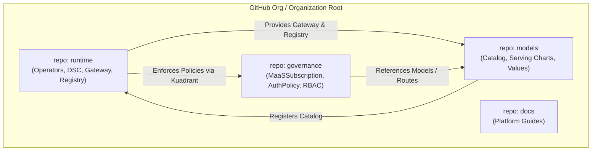
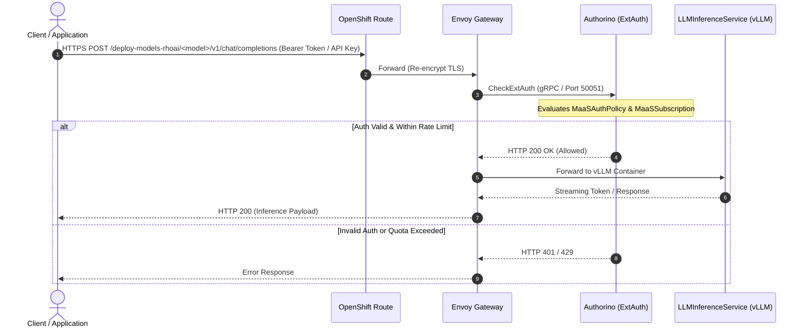

# MaaS Architecture & Component Relationships

This document outlines the system architecture, component interactions, network flows, and wave-based deployment sequencing for the Model as a Service (MaaS) platform.

---

## 1. High-Level System Architecture

```
┌────────────────────────────────────────────────────────────────────────────────────────┐
│                              IBM Storage Fusion — MaaS Platform                        │
├────────────────────────────────────────────────────────────────────────────────────────┤
│                                                                                        │
│   CLIENT ACCESS LAYER                                                                  │
│   ┌───────────────────────────┐    ┌───────────────────────────┐                       │
│   │   Enterprise Applications │    │   Agents / SDKs / Bifrost │                       │
│   └─────────────┬─────────────┘    └─────────────┬─────────────┘                       │
│                 │                                │                                     │
│                 ▼                                ▼                                     │
│   INGRESS & GOVERNANCE LAYER (Kuadrant + Envoy Gateway)                                │
│   ┌────────────────────────────────────────────────────────────────────────────────┐   │
│   │ OpenShift Route (Re-encrypt TLS) → Gateway: maas-default-gateway (Port 443)    │   │
│   │ Authorino (API key / OIDC)   │ Limitador (Rate Limiting)   │ EnvoyFilter       │   │
│   │ MaaSSubscription             │ MaaSAuthPolicy              │ Groups RBAC       │   │
│   └──────────────────────────────────────┬─────────────────────────────────────────┘   │
│                                          │ HTTP / gRPC                                 │
│                                          ▼                                             │
│   MODEL INFERENCE RUNTIME (RHOAI 3.5+ + KServe LLMInferenceService / vLLM)            │
│   ┌────────────────────────────────────────────────────────────────────────────────┐   │
│   │  Namespace: deploy-models-rhoai / per-model namespaces                         │   │
│   │  ┌───────────────────────┐  ┌───────────────────────┐  ┌──────────────────────┐│   │
│   │  │ Granite 4.1 (8B)      │  │ Qwen 2.5 / 3 (FP8)    │  │ GPT-OSS (20B)        ││   │
│   │  │ LLMInferenceService   │  │ LLMInferenceService   │  │ LLMInferenceService  ││   │
│   │  │ Accelerator: NVIDIA   │  │ Accelerator: NVIDIA   │  │ Accelerator: CPU/GPU ││   │
│   │  └───────────────────────┘  └───────────────────────┘  └──────────────────────┘│   │
│   └──────────────────────────────────────┬─────────────────────────────────────────┘   │
│                                          │ RWX / RWO Mounts & S3 Buckets               │
│                                          ▼                                             │
│   STORAGE & REGISTRY INFRASTRUCTURE (IBM Fusion Data Foundation & PostgreSQL)          │
│   ┌────────────────────────────────────────────────────────────────────────────────┐   │
│   │  • Model Registry Service (REST API + PostgreSQL Backend)                      │   │
│   │  • CephFS RWX PVCs (Model weights >50GB, Multi-GPU Tensor Parallelism)         │   │
│   │  • Ceph-RBD RWO PVCs (Single-node weights)                                     │   │
│   │  • NooBaa S3 ObjectBuckets (Staging & Fast artifact loading)                  │   │
│   └────────────────────────────────────────────────────────────────────────────────┘   │
└────────────────────────────────────────────────────────────────────────────────────────┘
```

---

## 2. Logical Repositories & Responsibilities



---

## 3. Wave-Based Deployment Sequencing

Deployments follow an ordered wave model using Helm or ArgoCD sync waves:

| Wave | Stage | Target Namespace | Chart / Component | Key Resources Created |
|---|---|---|---|---|
| **Wave 1** | Operators | `openshift-operators`, `redhat-ods-operator` | `runtime/charts/maas-operators` | Subscriptions: RHOAI, Kuadrant, Authorino, Limitador, LeaderWorkerSet |
| **Wave 2** | Platform Infrastructure | `redhat-ods-applications`, `maas-model-registry-db` | `runtime/charts/maas-platform` | DataScienceCluster (`default-dsc`), PostgreSQL StatefulSet, SecretStore |
| **Wave 3** | Runtime Services | `openshift-ingress`, `redhat-ai-gateway-infra`, `rhoai-model-registries` | `runtime/charts/maas-runtime`, `runtime/charts/maas-model-registry` | Gateway (`maas-default-gateway`), Authorino TLS Config, OpenShift Route, Model Registry REST Service |
| **Wave 4** | Model Serving Instances | `deploy-models-rhoai` (or custom) | `models/charts/maas-model-service` / `maas-model-deploy` | `LLMInferenceService`, `MaaSModelRef`, HTTPRoute, vLLM Pods |
| **Wave 5** | Governance & Access Control | `redhat-ai-gateway-infra` | `governance/charts/maas-config` | `MaaSSubscription`, `MaaSAuthPolicy`, User Groups |

---

## 4. Request Flow & Auth Verification


