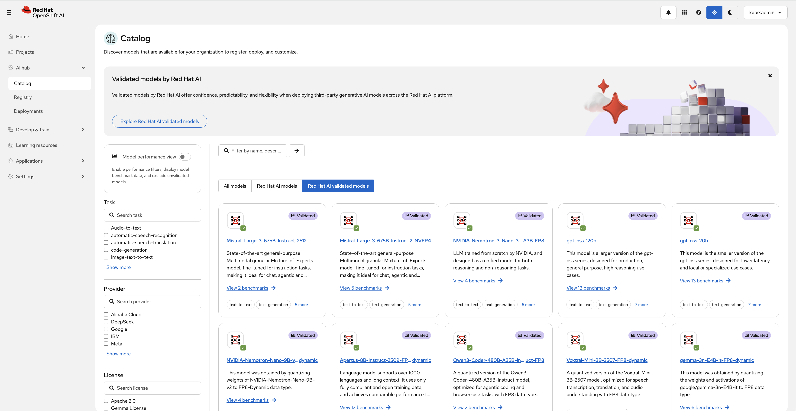
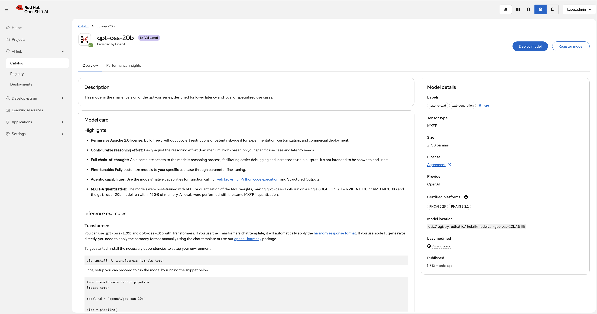
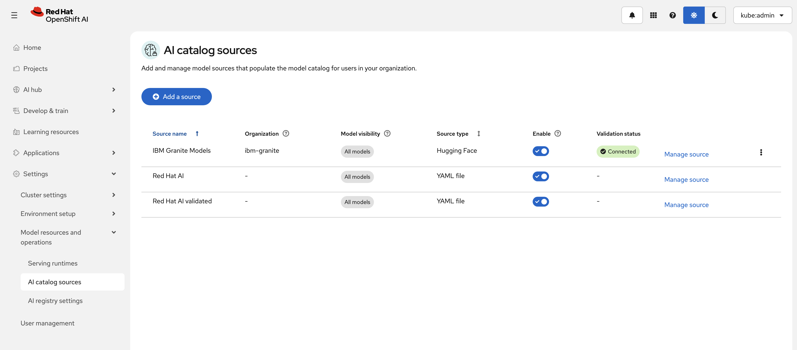

# Adding a Model Catalog Source

## Overview

Model Catalog Sources allow administrators to make additional model repositories available in the OpenShift AI Catalog. After a catalog source is added and synchronized, users can discover, evaluate, register, and deploy models directly from the Catalog UI.

## Prerequisites

- You are logged in to the OpenShift AI dashboard with administrator privileges.
- The AI Hub component is enabled.
- You have access to the catalog source location (for example, a Hugging Face organization or a custom catalog YAML file).

## Create a New Catalog Source

1. In the OpenShift AI dashboard, navigate to:
   
   **Settings → Model resources and operations → AI catalog sources**
   
   

2. Click **Add source**.

3. Select the catalog source type:
   
   **Option 1: Hugging Face Repository**
   - Enter the Hugging Face organization name (for example, `ibm-granite` or `meta-llama`).
   
   **Option 2: Custom YAML Catalog**
   - Upload a catalog YAML file or paste the YAML content directly into the editor.

4. Configure the catalog source details:
   - **Name** – Friendly name displayed in the Catalog UI.
   - **Description** (optional).
   - **Visibility settings** – Control which models from the source are available to users.
   
   

5. Click **Add**.

6. Wait for the synchronization to complete.
   

## Verify the Catalog Source

1. Navigate to **AI Hub → Catalog**.
2. Verify that the newly added catalog source appears in the list of available providers.
3. Search for models from the newly added source.
4. Open a model card to confirm the model metadata and registration options are available.

## Example: Adding Private Air-Gapped Catalog (Custom YAML)

For an air-gapped or private enterprise deployment on IBM Storage Fusion, use the pre-configured [`models/catalog/private-model-catalog.yaml`](../../models/catalog/private-model-catalog.yaml):

| Field | Value |
| --- | --- |
| **Source Type** | Custom YAML Catalog (YAML file) |
| **Source Name** | `IBM Fusion Enterprise Catalog` |
| **Model Visibility** | `All models` |

### Custom Catalog Schema (`private-model-catalog.yaml`):

```yaml
source: "IBM Fusion Enterprise"
models:
  - name: "nemotron-3-ultra-550b-nvfp4"
    description: "NVIDIA Nemotron 3 Ultra 550B NVFP4 parameter model optimized for 4x Blackwell / RTX GPUs on IBM Storage Fusion."
    readme: |-
      # NVIDIA Nemotron 3 Ultra 550B NVFP4
      Enterprise ultra-scale model deployed locally on IBM Storage Fusion.
      - **Parameters**: 550 Billion
      - **Precision**: NVFP4
      - **Inference Runtime**: vLLM (Tensor Parallelism = 4)
    provider: "NVIDIA / IBM Fusion"
    license: "Custom Enterprise"
    artifacts:
      - uri: "s3://models/nemotron-3-ultra-550b-nvfp4/"

  - name: "granite-3.1-8b-instruct"
    description: "IBM Granite 3.1 8B Instruct LLM hosted internally on IBM Fusion Data Foundation."
    readme: |-
      # IBM Granite 3.1 8B Instruct
      Enterprise instruction-tuned LLM optimized for code generation.
    provider: "IBM"
    license: "apache-2.0"
    licenseLink: "https://www.apache.org/licenses/LICENSE-2.0.txt"
    artifacts:
      - uri: "s3://models/granite-3.1-8b/"
```

**Result:** After adding this source, your air-gapped models are immediately discoverable under **AI Hub → Models → Catalog** with zero public internet access or external Hugging Face tokens required.

